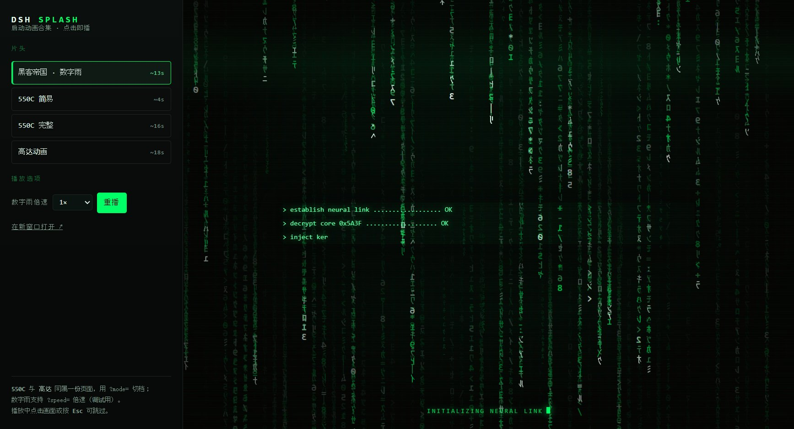
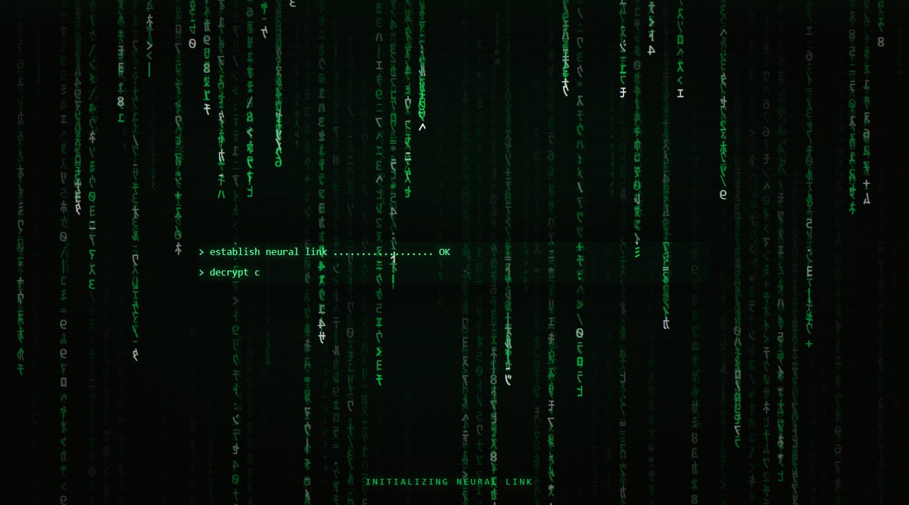
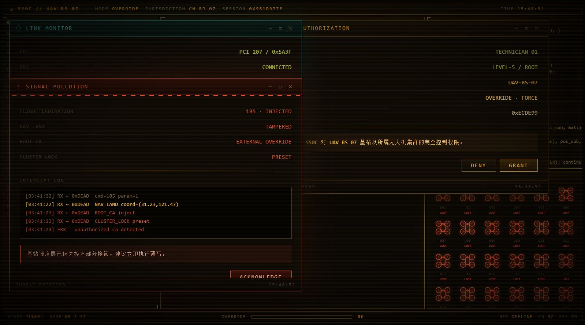

# DSH Splash · 启动动画合集

三个可以直接打开就播的开机片头：**黑客帝国数字雨**、**550C（简易 / 完整）**、**高达动画**。
纯前端单文件，不依赖构建、不依赖 npm，可以嵌进任何桌面壳（WebView2 / Electron / Tauri），
也可以直接丢进浏览器当全屏动画看。

> 个人兴趣项目，**非官方**，与任何影视作品权利人无关。素材来源与授权见 [NOTICE.md](NOTICE.md)。

**在线预览：** <https://chrisyoung2025.github.io/dsh-splash/demo/>（Pages 分支为 `main` / root；
或本地双击 `demo/index.html`）。




## 三个片头

| 片头 | 预览 | 时长 | 说明 |
|---|---|---|---|
| **黑客帝国 · 数字雨** |  | ~13s | 左右镜像代码雨（远近双层景深 / 整列爆亮 / 镜头缓推）→ 终端日志 → `ACCESS GRANTED` → 硬切黑场 → 片尾衬线标题卡 → 逐字飘散 |
| **550C 简易** |  | ~4s | 550C logo 逐路径书写，写完即交接 |
| **550C 完整** |  | ~16s | logo 之后继续跑 47 节点覆写的终端流程（含授权弹窗、链路监控等桥段） |
| **高达动画** |  | ~18s | 静音 H.264 视频，按比例居中，播完自动交接 |

数字雨更多截图：[ACCESS GRANTED](screenshots/matrix-2.jpg) ·
[片尾标题卡](screenshots/matrix-3.jpg) · [逐字飘散](screenshots/matrix-4.jpg)

数字雨还带了 `prefers-reduced-motion` 适配、`?speed=2` 倍速调试、页面被遮挡时按真实时间追帧，
以及「页面先就绪就提前收尾」的 `hurry()`。

## 快速开始

```bash
git clone https://github.com/ChrisYoung2025/dsh-splash.git
cd dsh-splash
# 方式一: 直接打开某个片头
start splashes/matrix/index.html
# 方式二: 打开带切换器的预览页
start demo/index.html
```

- 播放中**点击画面**或按 **Esc** 跳过。
- 550C 用 `?mode=simple|full|gundam` 选档；数字雨用 `?speed=2` 倍速。

## 接进自己的壳

三个片头共用一套极简宿主桥：

```js
// 网页 → 宿主
{ t: "ready" }   // 可以下播放指令了
{ t: "done"  }   // 已淡到片头底色, 收起遮罩

// 宿主 → 网页
window.dsh550c.play("simple" | "full" | "gundam" | "matrix");
window.dsh550c.skip();
window.dsh550c.note("正在启动本地服务…");
window.dsh550c.hurry();          // 可选, 仅数字雨档实现
```

完整协议、WebView2 / iframe 两套接入示例、以及三个容易踩的坑（自动播放策略、首帧防白闪、
兜底时限）见 **[docs/host-contract.md](docs/host-contract.md)**。

## 目录结构

```
dsh-splash/
├─ splashes/
│  ├─ matrix/index.html     黑客帝国数字雨(原创)
│  └─ 550c/index.html       550C 简易/完整/高达(派生自 dsh-550c-boot)
├─ assets/gundam.mp4        高达档用的视频
├─ demo/index.html          预览切换器(GitHub Pages 可直接用)
├─ screenshots/             README 用的截图
├─ docs/host-contract.md    宿主桥协议 + 接入示例
├─ docs/third-party/        上游许可证原文
├─ LICENSE                  本项目代码: MIT
└─ NOTICE.md                第三方素材来源与权利声明
```

## 授权与致谢

- **本项目代码**：[MIT](LICENSE) © 2026 ChrisYoung2025。
- **550C 片头**：派生自 [dsh-550c-boot](https://github.com/yannicksong0106/dsh-550c-boot)
  （MIT © Ziyang Song），动画与 HTML 原稿由 [Voidpocket](https://github.com/Voidpocket) 提供。
  上游许可证原文保留在 `docs/third-party/`。
- **高达视频**：版权归原权利人（SUNRISE 等）所有，此处仅作个人非商业分享，如要求下架立即删除。
- **数字雨**：本项目手写；风格致敬《黑客帝国》系列，不使用其官方素材。

细节与删除承诺见 [NOTICE.md](NOTICE.md)。
